<table>
<tr>
<td width="370" valign="top"></td>
<td width="490" valign="top"></td>
</tr>
</table>

 

## About

Master's in **Data Science & Artificial Intelligence** (Mundiapolis, 2026) on top of a
Bachelor's in **Full Stack Development** — which means I own the whole path, from the
data pipeline to the model to the interface someone actually clicks.

Most recently at **DISLOG GROUP**: built an ETL pipeline centralizing ERP data into a
SQL Server warehouse, then ran customer segmentation (RFM + K-Means), churn prediction
(**XGBoost, AUC-ROC 0.81**) and CLV modeling on top of it, with a Power BI layer for the
business side.

Currently working with LLMs — RAG systems, fine-tuning with LoRA/PEFT — and computer
vision. **Open to Data Scientist / Data Engineer / AI Developer roles.**

 

## Stack

**Languages** &nbsp;`Python` `SQL` `Java` `JavaScript` `C/C#` `PHP`

**ML & AI** &nbsp;`scikit-learn` `XGBoost` `PyTorch` `TensorFlow` `Keras` `OpenCV` `YOLOv8`

**Generative AI** &nbsp;`LLM` `RAG` `LoRA/PEFT` `LangChain` `ChromaDB` `Hugging Face`

**Data Engineering** &nbsp;`ETL` `Data Warehousing` `SQL Server` `MongoDB` `MySQL` `Power BI`

**Web & Mobile** &nbsp;`React` `Node.js` `.NET` `REST APIs` `Flutter`

**Tools** &nbsp;`Git` `Docker` `Jupyter` `MLflow` `AWS` `Azure`

 

## Selected work

| Project | What it does | Result |
|---|---|---|
| **Customer intelligence @ DISLOG** | ETL → SQL Server DW, RFM + K-Means segmentation, churn model, CLV | AUC-ROC **0.81** |
| **AI Legal Assistant — Moroccan law** | RAG chatbot: legal corpus indexing, embeddings + vector search, source-grounded answers | LangChain · ChromaDB |
| **Oil spill detection** | Deep learning segmentation on satellite imagery | IoU **0.88** |
| **Student behavior detection** | YOLOv8 object detection | mAP50 **0.80** |
| **Global markets sentiment** | 10k+ articles scraped (BBC, Bloomberg, Reuters) + NLP sentiment vs. volatility | 4 Power BI dashboards |

 

## Stats

 

[**Portfolio**](https://symo-portfolio.pages.dev) &nbsp;·&nbsp;
[**LinkedIn**](https://linkedin.com/in/mohammed-fakir) &nbsp;·&nbsp;
[**Email**](mailto:mr.fakir.mohammed@gmail.com)

