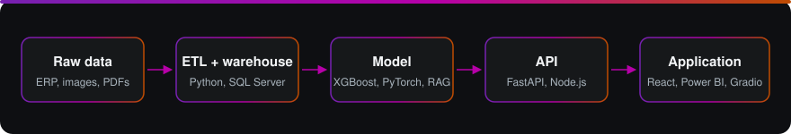

  

  

  
  
  
  
  

 

I started as a full stack developer and moved into data science, so I tend to build the whole chain: the pipeline that cleans the data, the model, and the API or interface that makes it usable by someone else. Master's in Data Science and AI (Mundiapolis University, Casablanca, 2026), Bachelor's in Applied Computer Science before that.

My final-year internship was on real company data rather than a prepared dataset: a SQL Server data warehouse fed by a Python ETL pipeline (9.2M sales lines, 104,794 customers), RFM and K-Means segmentation, churn prediction with XGBoost (ROC-AUC 0.81) and a four-page Power BI dashboard on top. That work is under NDA, so the repository is private; the projects below are the public ones.

Looking for a Data Scientist, Data Engineer or AI Developer role.

  

---

### Projects

| Project | What it does | Result | Built with |
|---|---|---|---|
| [**AI Legal Assistant — Moroccan Law**](https://github.com/Symooomzip/AI-Legal-Assistant-Moroccan-Law---RAG-based-System) | Bilingual (French / Arabic) RAG assistant that retrieves the relevant articles and answers with its sources. Vector search weighted by article number, GPT-4o with automatic fallback to Llama 3.3. | 10 legal texts indexed as 1,352 chunks | FastAPI, React, ChromaDB, sentence-transformers |
| [**Student Behavior Detection**](https://github.com/Symooomzip/student-behavior-detection-yolov8) | YOLOv8m detecting five classroom behaviors on a dataset the team filmed and annotated (425 images, 4,271 boxes). Image, video and webcam demo. | mAP50 0.81 in the original run, see note below | PyTorch, Ultralytics, Gradio |
| [**Oil Spill Segmentation**](https://github.com/Symooomzip/oil-spill-detection-ml) | Comparison of five segmentation architectures (U-Net, UNet++, DeepLabV3+) with pre-trained encoders on satellite and aerial images. | Best model U-Net / MiT-B2, validation IoU 0.88 | PyTorch, segmentation-models-pytorch, Gradio |
| [**LoRA Fine-Tuning of a Code LLM**](https://github.com/Symooomzip/lora-codegen-finetuning) | CodeGen-350M fine-tuned on 16,750 instruction / Python code pairs, with a Streamlit app comparing the base and fine-tuned models side by side. | 0.73% of parameters trained, eval loss 0.70 | PyTorch, Hugging Face PEFT, Streamlit |
| [**This portfolio**](https://symo-portfolio.pages.dev) | The site itself, with an assistant that answers questions about my work and is restricted to a written knowledge base so it cannot invent experience. | Live | React, TypeScript, Cloudflare Workers AI |

**A note on the numbers.** I report what the files show, including when it is less flattering. The student-behavior notebook augmented the dataset before splitting it, so copies of the same photo could land in both train and test: the 0.81 is an upper bound. I rebuilt the pipeline to split first and augment the training set only, and added a test that fails if a source image appears in two splits. The oil spill score is a validation score, not a test score. The LoRA project has an evaluation loss and no code-correctness benchmark.

---

### Stack

  

  
  
  

Arabic (native) · French (fluent) · English (fluent)

